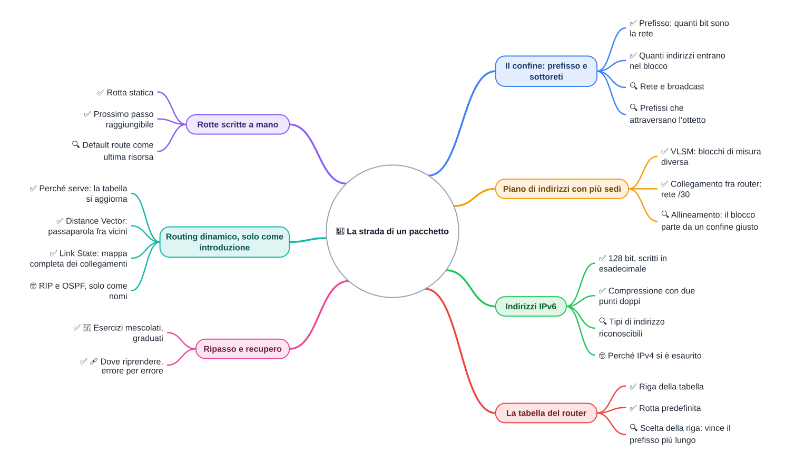

⬅️ [S6](./%28STU%29%204DI%20nov-dic%20S6%20-%20Introduzione%20al%20routing%20dinamico.md) · 🏠 [Indice](../README.md)

# 🧠 Ripasso e recupero

**4DI · Novembre-Dicembre · S7 · Teoria**

⏱️ **Tempo di studio: circa 60 minuti**, in tre sessioni brevi. ✅ essenziale: 35 min. 🔍 per il voto alto: 25 min. 🤓 si può saltare. Nessun argomento nuovo, nessun compito obbligatorio a casa. I valori degli esercizi sono inventati per l'esercizio, salvo dove è dichiarato reale.

> **Legenda:** ✅ da sapere · 🔍 per capire fino in fondo · 🤓 facoltativo · 📜 storia · ⚙️ tecnica · 🧪 esempio · 🧠 da ricordare · ✏️ da fare · ⚠️ errore comune · 🔁 ripasso · 🩹 recupero · 🔧 in laboratorio · 🃏 flashcard (rispondi a voce, poi apri)

## 🗺️ Mappa del bimestre

## 📜 Il pacchetto e il confine

📜 Il 29 ottobre 1969 due computer dell'ARPANET, uno all'UCLA e uno allo SRI in California, provano a scambiarsi la parola «LOGIN». Arrivano solo le prime due lettere, «LO», poi il sistema va in crash. Era il primo collegamento fra due reti, e la strada era ancora tutta da costruire.

Da allora la rete è cresciuta, e i confini sono diventati la parte più delicata. Il 3 febbraio 2011 la IANA assegna gli ultimi grandi blocchi liberi di IPv4. Nel 2012, il 6 giugno, il *World IPv6 Launch* porta IPv6 su grandi servizi.

<u>Un pacchetto non conosce la rete intera: segue confini disegnati da qualcuno.</u>

## Il confine: prefisso e sottoreti

Ripasso di S1: il numero dopo la barra, per esempio `/20`, dice quanti bit sono la rete. I bit restanti sono per gli host. Quindi <u>un prefisso `/n` lascia `32 − n` bit per gli host</u>, e gli indirizzi del blocco sono $2^{32-n}$.

🧪 **Esempio svolto (inventato):** `10.20.0.0/20`.
- Bit host: $32 - 20 = 12$; indirizzi: $2^{12} = 4096$.
- Salto nel terzo ottetto: $256 - 240 = 16$. Quindi i blocchi partono su 0, 16, 32, …
- Rete `10.20.0.0`, ultimo indirizzo (broadcast) `10.20.15.255`.

⚙️ **Metodo a due passi:** 1) calcola il salto: $256 -$ ottetto della maschera che non è 255; 2) la rete è il multiplo del salto in cui cade l'indirizzo.

*Un blocco grande diviso in pezzi più piccoli: ogni pezzo ha il suo confine.*

### ✅ Che cosa ricordare

- <u>Host ordinari = $2^h - 2$</u>: rete e broadcast non si assegnano.
- Più il prefisso è lungo, più il blocco è piccolo.
- Un `/27` ha 32 indirizzi e 30 host ordinari.

### 🔍 Prefissi che attraversano l'ottetto

🧪 **Esempio (inventato):** `172.16.200.50/22`.
- Bit host: $32 - 22 = 10$; indirizzi: $2^{10} = 1024$.
- Salto nel terzo ottetto: $256 - 252 = 4$. Il `200` è multiplo di 4, quindi la rete è `172.16.200.0`.
- Broadcast: `172.16.203.255`, l'ultimo del blocco.

⚠️ Errore comune: cercare il salto nel quarto ottetto. Il salto sta nell'ottetto dove la maschera smette di valere 255.

🃏 <b>Quanti indirizzi ha un prefisso /20?</b>

4096, cioè $2^{12}$.

🃏 <b>Quanti host ordinari ha un /27?</b>

30: dai 32 indirizzi si tolgono rete e broadcast.

🃏 <b>Come si calcola il salto?</b>

256 meno l'ottetto della maschera che non è 255; per esempio $256 - 240 = 16$.

🃏 <b>Qual è il broadcast del blocco 172.16.200.0/22?</b>

172.16.203.255, l'ultimo indirizzo del blocco.

🃏 <b>Perché 172.16.203.9 sta nel blocco 172.16.200.0/22?</b>

*Perché cade fra 172.16.200.0 e 172.16.203.255.*

🃏 <b>Quanti /26 ci sono in un /24?</b>

4, ciascuno con 62 host ordinari.

🃏 <b>Che cosa indica il numero dopo la barra?</b>

Quanti bit sono la parte di rete dell'indirizzo.

🃏 <b>Qual è la differenza fra un'azienda con una /28 e una con una /24?</b>

La /28 ha 16 indirizzi e 14 host ordinari; la /24 ha 256 indirizzi e 254 host ordinari.

✏️ **Prevedi, poi calcola (3 min).** Senza calcolare, scrivi quanti indirizzi ha un `/22` e quanti host ordinari ha un `/27`. Poi verifica con il metodo a due passi.

✏️ **Traccia la riga (5 min).** Per `10.20.40.77/20`: dove inizia e dove finisce il blocco? Scrivi i multipli del salto e segna quello giusto.

✏️ **Trova l'errore (2 min).** Una tabella dice: rete `172.16.200.0/22`, broadcast `172.16.200.255`. Quale controllo di sett-ott avrebbe già scoperto l'errore?

## Piano di indirizzi: VLSM e collegamenti

Ripasso di S2: VLSM significa blocchi di dimensioni diverse. Si assegnano partendo dal più grande, ognuno <u>allineato</u> (inizia su un multiplo della sua dimensione) e poi controllato.

⚙️ **Regola nuova:** <u>ogni collegamento fra due router è una rete `/30`: quattro indirizzi in tutto, due host utili, uno per ogni router.</u>

⚠️ Errore comune: contare il collegamento come un host, o dimenticarlo nel piano. Anche il collegamento occupa indirizzi.

🧪 **Il problema tipo:** un blocco `192.168.80.0/24` da dividere fra tre sedi (A con 28 host, B con 14, C con 6) e due collegamenti (A-B e B-C). Il metodo è sempre lo stesso: dimensiona, ordina, allinea, controlla.

🃏 <b>Perché un collegamento fra router ha un /30?</b>

Servono due host, uno per ogni router, più rete e broadcast: quattro indirizzi.

🃏 <b>Quanti host utili ha un /30?</b>

Due.

🃏 <b>Che cosa significa VLSM?</b>

Dividere un blocco in sottoreti di dimensioni diverse, assegnate dalla più grande alla più piccola.

🃏 <b>Che cosa vuol dire allineato?</b>

Che il blocco inizia su un multiplo della propria dimensione: un /28 parte da 0, 16, 32…

🃏 <b>Quanti host ordinari ha un /29?</b>

Sei.

🃏 <b>Un /28 quanti host ordinari ha, e quanti indirizzi?</b>

14 host ordinari su 16 indirizzi.

🃏 <b>Perché si parte dal blocco più grande?</b>

Perché deve trovare un confine libero; i blocchi piccoli si incastrano dopo.

✏️ **Costruisci la tabella (10 min).** Usa il problema tipo: per ogni blocco scrivi rete, prefisso, primo host e broadcast. Controlla che nessun intervallo si sovrapponga.

✏️ **Disegna (4 min).** Traccia tre cerchi (le sedi) e due linee (i collegamenti). Accanto a ogni linea scrivi il prefisso che le serve.

## IPv6: lo spazio nuovo

📜 Con 32 bit IPv4 ha circa 4,3 miliardi di indirizzi ($2^{32} = 4\,294\,967\,296$). IPv6 ha 128 bit: circa $3{,}4 \times 10^{38}$ indirizzi. Non è solo un numero più grande: il prefisso resta, cambia la lunghezza.

Ripasso di S3: un indirizzo IPv6 è fatto di otto gruppi di 16 bit, scritti in esadecimale, separati da due punti.

🧪 **Esempio:** `2001:0db8:0000:0000:0000:0000:0000:0001`, compresso in `2001:db8::1`. Il prefisso `2001:db8::/32` è reale: è riservato alla documentazione (RFC 3849).

⚙️ **Compressione in tre passi:**
1. Togli gli zeri iniziali di ogni gruppo: `0db8` diventa `db8`.
2. Una sola sequenza di gruppi tutti zero diventa `::`.
3. <u>Il `::` si usa una sola volta.</u>

✅ **Tre tipi riconoscibili dal primo gruppo:**
- globale, il pubblico (`2000::/3`);
- link locale, valido solo sul tratto di rete (`fe80::/10`);
- multicast, un gruppo di nodi (`ff00::/8`; `ff02::1` sono tutti i nodi del collegamento locale).

⚠️ Errore comune: pensare che con IPv6 il prefisso non serva più. Serve sempre: dice dove finisce la rete.

### 🔍 Il /64 delle reti locali

Nelle reti locali si usa molto un prefisso `/64`. È una prassi comune, non un obbligo: lascia uno spazio di host molto grande, più di quanto serva. Non va confuso con «64 host».

### 🤓 Perché IPv4 si è esaurito

> Gli indirizzi IPv4 sono stati assegnati a blocchi per decenni. Il NAT, visto in sett-ott, ha tamponato il problema. IPv6 è la soluzione strutturale, ma non ha ancora sostituito IPv4 ovunque: convivono.

🃏 <b>Quanti bit ha un indirizzo IPv6?</b>

128, divisi in otto gruppi da 16 bit.

🃏 <b>Quante volte si può usare :: in un indirizzo?</b>

Una sola.

🃏 <b>Che cosa indica fe80::/10?</b>

Un link locale: vale solo sul tratto di rete locale, non va oltre il router.

🃏 <b>Che cosa indica ff02::1?</b>

Un gruppo multicast: tutti i nodi del collegamento locale.

🃏 <b>Quante cifre esadecimali ha un gruppo IPv6 prima della compressione?</b>

Quattro, che rappresentano 16 bit.

🃏 <b>Quanti indirizzi circa ha IPv4, e perché?</b>

Circa 4,3 miliardi, perché sono 2^32 combinazioni di 32 bit.

🃏 <b>Quale prefisso è riservato alla documentazione?</b>

2001:db8::/32, un valore reale riservato a esempi e manuali.

🃏 <b>Perché ha senso dire che il prefisso «resta»?</b>

*Perché anche in IPv6 il prefisso dice dove finisce la rete; cambia solo quanto è lungo l'indirizzo.*

✏️ **Comprimi (2 min).** Scrivi la forma compressa di `2001:0db8:0000:0000:0042:0000:0000:0001`. Dì in una frase dove hai messo `::`.

✏️ **Trova l'errore (2 min).** L'indirizzo `2001:db8::42::1` non è valido. Quale regola viola? Scrivila con parole tue.

## La tabella del router

Ripasso di S4: lo switch lavora nel tratto locale, con i MAC. Il router collega reti diverse e sceglie la strada fra loro. Per farlo usa la sua tabella.

🧪 **Scena (valori inventati):** una scuola con tre reti collegate da un router: aula `172.20.1.0/24`, server `172.20.2.0/24`, segreteria `172.20.3.0/24`. Una riga porta verso il provider.

| Rete di destinazione | Prefisso | Prossimo passo |
|---|---|---|
| 172.20.1.0 | /24 | collegata: aula |
| 172.20.2.0 | /24 | collegata: server |
| 172.20.3.0 | /24 | collegata: segreteria |
| 0.0.0.0 | /0 | router del provider |

🧠 <u>Il router sceglie la riga che contiene l'indirizzo di destinazione. Se nessuna riga corrisponde, usa la rotta predefinita.</u>

### ✅ Prossimo passo, non destinazione

Il prossimo passo è l'indirizzo del router a cui consegnare il pacchetto. Non è la destinazione finale. ⚠️ Lo switch non decide la strada fra reti: se il pacchetto deve uscire, serve un router.

### 🔍 Quando due righe corrispondono

🧪 **Esempio:** l'indirizzo `172.20.2.9` cade sia in `172.20.2.0/24` sia in `0.0.0.0/0`. Vince `172.20.2.0/24`, perché il prefisso è più lungo, quindi più preciso.

🃏 <b>Che cosa fa un router che lo switch non fa?</b>

Collega reti diverse e sceglie la strada fra loro.

🃏 <b>Che cos'è la rotta predefinita?</b>

La riga 0.0.0.0/0: si usa quando nessun'altra riga corrisponde.

🃏 <b>Che cosa significa prossimo passo?</b>

L'indirizzo del router a cui consegnare il pacchetto, non la destinazione finale.

🃏 <b>Quale riga vince se due corrispondono?</b>

Il prefisso più lungo, cioè quello più preciso.

🃏 <b>Che cosa contiene una riga della tabella?</b>

Rete di destinazione, prefisso e prossimo passo (o interfaccia d'uscita).

🃏 <b>Un router conosce tutta Internet?</b>

No: conosce solo le righe della sua tabella.

✏️ **Prevedi la riga (2 min).** Per `172.20.3.200` e per `8.8.8.8`, scrivi prima la riga che sceglie il router, poi controlla con la regola.

✏️ **Disegna il percorso (4 min).** Sullo schema a tre reti, traccia dove va un pacchetto per `172.20.2.9` partendo dall'aula, e segna la riga in cui si decide.

## Rotte statiche e default route

Ripasso di S5: una rotta statica è una riga scritta a mano. Funziona finché la rete è piccola e nessuno la cambia. Ogni rotta ha tre parti: rete di destinazione, prefisso, prossimo passo.

🧪 **Topologia (valori inventati):** sede A `192.168.80.0/27`, sede B `192.168.80.32/28`, sede C `192.168.80.48/29`. Collegamento A-B `192.168.80.56/30` (host `.57` su A, `.58` su B). Collegamento B-C `192.168.80.60/30` (host `.61` su B, `.62` su C).

✅ **Controllo a due passi:**
1. il prossimo passo è raggiungibile?
2. sta nella rete collegata al router che scrive la riga?

Se la risposta al secondo è no, la rotta non funziona: il prossimo passo non si raggiunge.

### ✅ Default route

La rotta predefinita `0.0.0.0/0` ha zero bit di rete: corrisponde a tutto, ma vince solo quando nessun'altra riga corrisponde. ⚠️ Non è «la rotta per tutta Internet»: è l'ultima risorsa.

### 🔍 Il limite del routing statico

Su una rete di dieci router, ogni cambio va riscritto a mano su ciascun router. Con poche righe è chiaro; con molte, la mappa si sbaglia. Questo è il motivo del routing dinamico.

🃏 <b>Che cos'è una rotta statica?</b>

Una riga scritta a mano dal tecnico, che non cambia da sola.

🃏 <b>Che cosa controlli per primo nel prossimo passo?</b>

Che sia raggiungibile, cioè che stia nella rete collegata al router.

🃏 <b>Quando si usa la default route?</b>

Quando nessuna riga della tabella corrisponde all'indirizzo.

🃏 <b>Perché il routing statico non scala?</b>

*Perché ogni cambio va riscritto su ogni router, a mano.*

🃏 <b>Quale prefisso ha la rotta predefinita?</b>

/0: zero bit di rete, quindi corrisponde a qualunque indirizzo.

✏️ **Scrivi la riga (4 min).** Dalla topologia sopra, scrivi la riga del router B verso la sede A: rete, prefisso e prossimo passo. Controlla con il controllo a due passi.

## Routing dinamico: passaparola o mappa

📜 Nei primi anni dell'ARPANET le tabelle si aggiornavano con il passaparola fra vicini. Alla fine degli anni '70 si passò a calcolare i percorsi da una mappa dei collegamenti. Il routing dinamico è questa idea: la tabella si aggiorna da sola quando un collegamento cade.

🧪 **Triangolo (costi inventati):** sedi A, B e C. Collegamento A-B con costo 1, B-C con costo 2, A-C diretto con costo 5. Il costo è un numero che confronta i percorsi: più è alto, più il percorso è «caro». Da A verso C, passare per B costa $1 + 2 = 3$; il diretto costa 5.

### ✅ Distance Vector

Ogni router dice ai vicini: «so andare a X con costo d». È il passaparola. Analogia: chiedi la strada a chi incontri, senza mappa. ⚠️ Il passaparola può portare notizie vecchie.

### ✅ Link State

Ogni router conosce la mappa dei collegamenti di tutta la rete e calcola da solo il percorso migliore. Analogia: avere la pianta completa della città.

### 🤓 Nomi reali

> RIP è un protocollo *Distance Vector* (RFC 1058); OSPF è un protocollo *Link State* (RFC 2328). Qui solo i nomi: nessuna configurazione.

🃏 <b>Che cosa dice un router Distance Vector ai vicini?</b>

«So andare a X con costo d.»

🃏 <b>Che cosa ha un Link State che un Distance Vector non ha?</b>

La mappa completa dei collegamenti della rete.

🃏 <b>Perché esiste il routing dinamico?</b>

Perché la tabella si aggiorna quando un collegamento cade, senza riscriverla a mano.

🃏 <b>Come si chiama il principio del passaparola?</b>

Distance Vector.

🃏 <b>Che cosa misura il costo?</b>

Un numero che serve a confrontare i percorsi e scegliere il più conveniente.

🃏 <b>Un router Distance Vector può ricevere informazioni vecchie?</b>

Sì, perché si fida di quello che sente dai vicini, che può essere già superato.

✏️ **Prevedi (3 min).** Nel triangolo cade il collegamento A-B. Quale percorso usa A per arrivare a C, e con quale costo? Scrivi la risposta prima di confrontare.

✏️ **Spiega in una frase (1 min).** Perché un Distance Vector può usare notizie vecchie e un Link State meno?

## 🔁 Ripasso mescolato: esercizi graduati

I temi sono mescolati, senza indicare il metodo. Prima guarda i dati: sono un prefisso, un piano, un indirizzo IPv6 o una tabella?

✏️ **Base (5 min).** Dato `172.16.8.100/21`, trova rete e broadcast. Poi scrivi quanti host ordinari ha il blocco.

✏️ **Medio (10 min).** Alla topologia della sezione «Rotte statiche» aggiungi una sede D collegata alla sede C con un collegamento `/30`. Scegli un blocco libero dopo quelli già usati, dichiaralo, e scrivi la riga che il router C deve avere per raggiungere la sede D.

✏️ **Avanzato (10 min).** Il router B ha tre righe: `192.168.80.32/28` collegata, `192.168.80.56/30` collegata, `0.0.0.0/0` verso il provider. Arriva un pacchetto per `192.168.80.50`. Quale riga sceglie B? Quale riga manca per inoltrarlo verso la sede C, e che prossimo passo scrivi?

🃏 <b>Come si chiama il metodo per dividere un blocco in sedi di misura diversa?</b>

VLSM: blocchi di dimensioni diverse, assegnati dal più grande.

🃏 <b>Che cos'è la riga 0.0.0.0/0?</b>

La rotta predefinita, usata come ultima risorsa.

🃏 <b>Quale prefisso dà 16 indirizzi?</b>

/28, cioè $2^4 = 16$.

🃏 <b>Perché due punti doppi in IPv6 sono usabili una sola volta?</b>

Perché altrimenti non si saprebbe quanti gruppi di zeri ci sono in ciascun posto.

## 🩹 Recupero: dove riprendere

Il recupero non è un voto: è tornare al punto giusto. Quando un esercizio non torna, parti dall'errore e riprendi la settimana indicata.

| Se ti trovi in questo punto... | Riprendi |
|---|---|
| non sai quanti indirizzi ha un prefisso | [S1 nov-dic](./%28STU%29%204DI%20nov-dic%20S1%20-%20CIDR%20e%20subnetting.md) e [S5 sett-ott](../1%20SETT-OTT/%28STU%29%204DI%20sett-ott%20S5%20-%20CIDR%20e%20intervalli.md) |
| due blocchi che si sovrappongono | [S2 nov-dic](./%28STU%29%204DI%20nov-dic%20S2%20-%20VLSM.md) e [S6 sett-ott](../1%20SETT-OTT/%28STU%29%204DI%20sett-ott%20S6%20-%20VLSM%20e%20progettazione.md) |
| un IPv6 che non si comprime | [S3 nov-dic](./%28STU%29%204DI%20nov-dic%20S3%20-%20IPv6.md) |
| il router sceglie la riga sbagliata | [S4 nov-dic](./%28STU%29%204DI%20nov-dic%20S4%20-%20Router%20e%20tabelle%20di%20routing.md) |
| il prossimo passo non sta nella rete collegata | [S5 nov-dic](./%28STU%29%204DI%20nov-dic%20S5%20-%20Routing%20statico.md) |
| confondi passaparola e mappa | [S6 nov-dic](./%28STU%29%204DI%20nov-dic%20S6%20-%20Introduzione%20al%20routing%20dinamico.md) |

Prima di tornare indietro, ripercorri i sei controlli del troubleshooting di [S7 sett-ott](../1%20SETT-OTT/%28STU%29%204DI%20sett-ott%20S7%20-%20Ripasso%20e%20troubleshooting.md): il passaggio che non torna è quasi sempre uno solo.

## 🔧 In laboratorio

🔧 La rete di queste pagine si ricostruisce su Packet Tracer. Qui solo carta e matita: nessuna consegna e nessun comando.

## 📚 Fonti e risorse

- RFC 4632, *Classless Inter-domain Routing*: per consultazione sui prefissi, <https://www.rfc-editor.org/rfc/rfc4632>.
- RFC 791 (IPv4), RFC 4291 (indirizzamento IPv6), RFC 3849 (prefisso `2001:db8::/32`): <https://www.rfc-editor.org/>.
- RFC 1058 (RIP) e RFC 2328 (OSPF): solo per i nomi dei protocolli, in 🤓.
- Storia ARPANET e primo messaggio del 1969: <https://en.wikipedia.org/wiki/ARPANET>.
- Immagine: *Subnetting Concept-en.svg*, di Michel Bakni, su Wikimedia Commons, licenza CC BY-SA 4.0, <https://commons.wikimedia.org/wiki/File:Subnetting_Concept-en.svg>.

---

⬅️ [S6](./%28STU%29%204DI%20nov-dic%20S6%20-%20Introduzione%20al%20routing%20dinamico.md) · 🏠 [Indice](../README.md)
