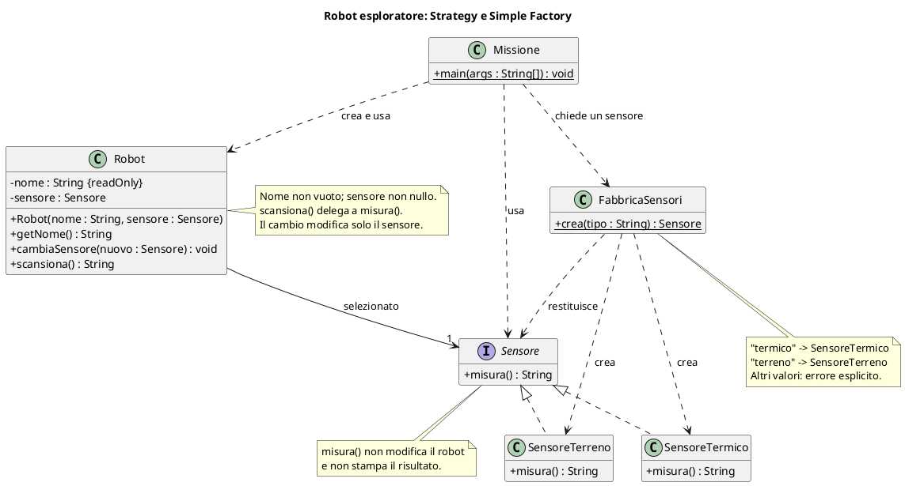

# 🤖 Dal testo al progetto: un robot esploratore

**4CI · Esercizio semplice · Strategy e Simple Factory · Prima UML, poi codice**

**Durata indicativa:** 15–20 minuti. Non è un'aggiunta obbligatoria alla precedente lezione di un'ora.

Non serve il computer: possiamo progettare alla lavagna o su un foglio. Il codice sarà un passo successivo.

## 1. Il testo di partenza

> Vogliamo simulare un robot che esplora un pianeta. Ogni robot ha un nome non vuoto e un sensore.
>
> Esistono due sensori simulati: quello termico restituisce «Temperatura simulata: −20 °C»; quello del terreno restituisce «Terreno simulato: roccioso».
>
> Il robot può scansionare e restituire la descrizione prodotta dal sensore selezionato. Può cambiare sensore senza essere ricreato e senza cambiare nome.
>
> Il programma riceve la scelta «termico» oppure «terreno». Un componente dedicato deve creare il sensore corrispondente. Una scelta sconosciuta deve produrre un errore esplicito, non un sensore scelto arbitrariamente.
>
> Il programma principale mostra la descrizione sullo schermo. Il robot e i sensori non devono stamparla direttamente.
>
> In futuro potremo aggiungere un sensore atmosferico senza riscrivere il metodo di scansione del robot.

Non occorrono hardware, casualità, librerie esterne, energia o audio: i risultati sono fissi e dichiaratamente simulati. La difficoltà sta soltanto nel decidere **chi crea il sensore** e **chi lo usa**.

## 2. Prima di disegnare: estraiamo i requisiti

**Consegna:** trasformare il testo in regole verificabili.

| ID | Domanda da risolvere |
|---|---|
| R1 | Quali dati possiede il robot? |
| R2 | Quale operazione comune offrono i sensori? |
| R3 | Chi trasforma la scelta testuale in un sensore concreto? |
| R4 | Che cosa accade per una scelta sconosciuta? |
| R5 | Chi stampa e chi restituisce il risultato? |
| R6 | Che cosa rimane invariato al cambio del sensore? |

**Non ogni sostantivo diventa una classe:** il nome è un attributo; «pianeta» non richiede qui una classe, perché il testo non chiede di rappresentarne stato e operazioni.

## 3. Consegna UML

Disegnare un diagramma delle classi contenente:

1. il robot, con attributi e operazioni essenziali;
2. un contratto comune ai sensori;
3. le due implementazioni iniziali;
4. una factory che crea il sensore a partire dalla scelta;
5. visibilità, tipi e relazioni;
6. una breve nota sul comportamento per una scelta sconosciuta.

**Vincoli:**

- nome e riferimento al sensore privati;
- sensore valido richiesto alla creazione e al cambio;
- nessuna stampa dentro il robot o i sensori;
- cambio del sensore senza ricreare il robot;
- evitare di confondere «ha un sensore» con «è un sensore».

**Metodo suggerito:** prima elencare responsabilità, poi metodi, infine frecce. Non partire disegnando una gerarchia soltanto perché abbiamo studiato `extends`.

## 4. Domande per il confronto

- Dove mettiamo la scelta fra «termico» e «terreno»?
- Il robot deve conoscere tutte le classi concrete dei sensori?
- Il metodo di scansione deve stampare o restituire una descrizione?
- Come aggiungiamo un sensore atmosferico?
- La factory restituisce un tipo concreto o il contratto comune?
- Per aggiungere un sensore, quali componenti cambiano e quali no?

## 5. Prima del codice: quattro prove su carta

Scrivere stato iniziale, operazione e risultato atteso:

1. Creiamo il sensore «termico» e scansioniamo: quale testo otteniamo?
2. Sullo stesso robot scegliamo «terreno»: quale testo otteniamo? Il nome cambia?
3. Chiediamo alla factory «magico»: che cosa deve accadere?
4. Proviamo a cambiare sensore passando un riferimento nullo: il robot deve accettarlo?

## 6. Soluzione possibile — aprire dopo il confronto

🔍 Mostra responsabilità, PlantUML e ragionamento

### Responsabilità

| Componente | Responsabilità |
|---|---|
| Robot | Conservare nome e sensore; delegare la scansione |
| Sensore | Definire il contratto comune di misura |
| Sensori concreti | Realizzare i diversi tipi di misura |
| FabbricaSensori | Tradurre la scelta in un sensore concreto |
| Missione | Usare la factory, creare il robot e stampare la descrizione |

Questo è un **progetto proposto**, non UML estratto da codice già implementato.

PlantUML richiede un renderer compatibile. La soluzione contiene soltanto sei tipi: due classi sensore, un'interfaccia, robot, factory e programma principale.

### Come funzionerebbe una scansione

1. Missione chiede alla factory il sensore «termico».
2. La factory crea un `SensoreTermico` e lo restituisce come `Sensore`.
3. Missione costruisce il robot «Ada» con quel sensore.
4. Il robot riceve la richiesta di scansione e chiama `misura()` sul sensore.
5. Il sensore restituisce il testo; il robot lo restituisce a Missione.
6. Missione stampa il risultato.

Se la misura fallisce, l'errore viene propagato o gestito esplicitamente dal chiamante: non si restituisce una descrizione inventata per fingere successo.

### Risultati delle prove

- Termico: «Temperatura simulata: −20 °C».
- Cambio a terreno: «Terreno simulato: roccioso»; il robot si chiama ancora Ada.
- Scelta «magico»: errore esplicito della factory, nessun sensore di ripiego.
- Cambio con riferimento nullo: errore esplicito; il sensore precedente rimane selezionato.

### I due schemi, senza confonderli

**Strategy — quale comportamento uso?** Il robot conserva un `Sensore` e lo usa. Possiamo sostituire la misura termica con quella del terreno senza cambiare `scansiona()`.

**Simple Factory — quale oggetto creo?** `FabbricaSensori` concentra la scelta fra le classi concrete. Il programma principale non ripete questa decisione.

Qui la factory può contenere un semplice `if` o `switch`: non stiamo eliminando ogni condizione, ma mettendo la decisione di creazione nel posto adatto.

**Precisazione:** Simple Factory è un idioma di creazione comune; non è il pattern GoF **Factory Method**, che prevede una decisione di creazione delegata a sottoclassi. Non aggiungiamo quella gerarchia perché qui non serve.

**Prova di estensione:** per l'atmosfera aggiungiamo `SensoreAtmosferico` e aggiorniamo la factory per riconoscere «atmosferico». Il robot non cambia. La factory centralizza la modifica, ma non è automaticamente chiusa a ogni modifica.

### Quali concetti abbiamo applicato?

- **Incapsulamento:** il riferimento al sensore cambia attraverso un'operazione controllata.
- **Polimorfismo:** il robot usa sensori diversi attraverso lo stesso contratto.
- **S:** creazione, misurazione e coordinamento sono separati.
- **O:** aggiungere il sensore atmosferico non richiede di riscrivere la scansione generale.
- **L:** un sensore nuovo restituisce la descrizione senza effetti nascosti incompatibili.
- **I:** il contratto del sensore richiede soltanto la misura.
- **D:** il robot dipende da `Sensore`, non da un sensore specifico.
- **Strategy e Simple Factory:** distinguono l'uso del comportamento dalla creazione dell'oggetto.

Anche una soluzione diversa può essere corretta se soddisfa i requisiti e motiva i compromessi. Non assegnare punti in base al numero di classi.

## 7. Mini-regia alla lavagna

1. **3 minuti:** leggere il testo e sottolineare responsabilità e variazioni.
2. **5 minuti:** disegnare robot, interfaccia e sensori: riconoscere Strategy.
3. **5 minuti:** chiedere «chi crea il sensore dalla parola scelta?» e aggiungere la factory.
4. **2–5 minuti:** seguire una scansione e proporre il sensore atmosferico.

**Domanda finale:** «La factory crea il sensore; chi lo usa?» Risposta: il robot. Questa distinzione è il centro dell'esercizio.

Per confrontare un progetto con codice già scritto: [Improvvisatore musicale — diagrammi PlantUML](Improvvisatore%20musicale%20-%20diagrammi%20PlantUML.md).
