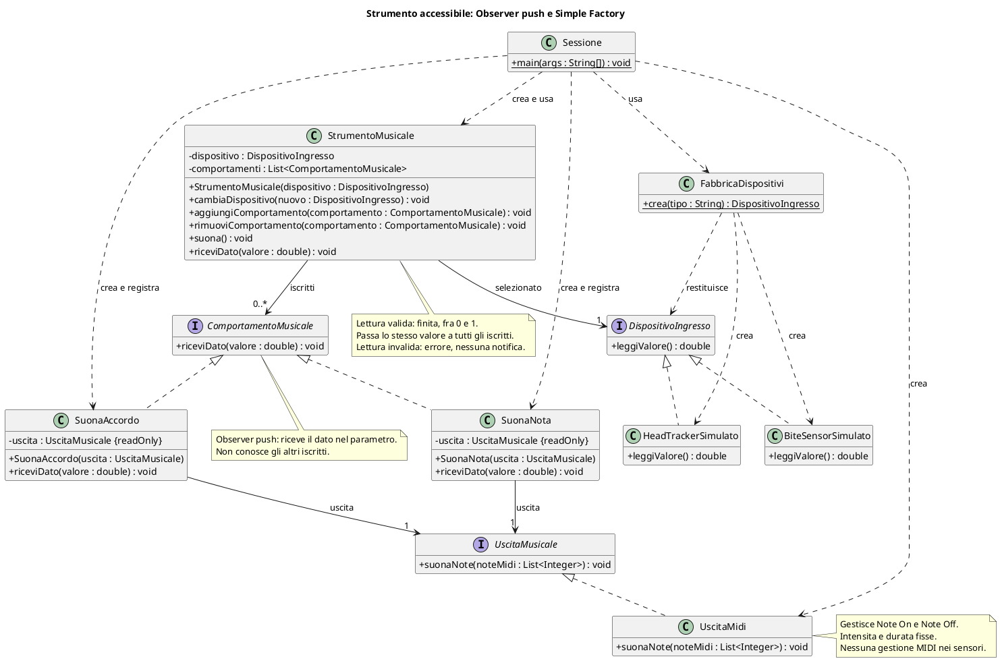

# 🎵 Dal testo al progetto: strumenti musicali accessibili

**4CI · Esercizio semplice · Observer, Simple Factory e SOLID · Prima UML, poi codice**

**Durata indicativa:** 15–20 minuti. Non serve il computer: si può progettare alla lavagna o su un foglio.

Il caso è ispirato al progetto di ricerca del docente: sviluppare strumenti musicali per persone con paralisi, utilizzando eye tracker, head tracker, sip-n-puff e bite sensor per controllare un sintetizzatore MIDI.

Questa è una **riduzione didattica**, non una ricostruzione dell'architettura originale né un sistema pronto all'uso con persone. Non trattiamo configurazione hardware, calibrazione, elaborazione continua dei segnali o sperimentazione con utenti.

## 1. Il testo di partenza

> Vogliamo simulare uno strumento musicale utilizzabile attraverso diversi dispositivi di ingresso, senza richiedere l'uso delle mani.
> Ogni dispositivo offre al programma un valore normalizzato fra 0 e 1. Per la prima versione abbiamo un bite sensor di pressione simulato: una lettura di prova equivale al 25% del suo intervallo calibrato e restituisce 0,25. Un head tracker simulato fornisce una lettura di prova di 0,75, corrispondente al 75% dell'intervallo di rotazione calibrato.
> Ogni dato valido viene passato a tutti i comportamenti musicali registrati, attraverso lo stesso metodo `riceviDato(valore)`.
> Il comportamento «nota singola» sceglie la nota MIDI 60 sotto 0,5 oppure 67 da 0,5 in poi. Il comportamento «accordo» sceglie do maggiore, note 60–64–67, sotto 0,5 oppure sol maggiore, note 67–71–74, da 0,5 in poi.
> Entrambi usano un'uscita MIDI con intensità e durata fisse. I dispositivi non inviano direttamente messaggi MIDI.
> Possiamo aggiungere e rimuovere comportamenti durante l'esecuzione. Se entrambi sono registrati, entrambi ricevono il dato; una lista vuota non produce musica.
> Deve essere possibile cambiare dispositivo senza ricreare lo strumento e senza perdere i comportamenti registrati.
> Un componente dedicato crea il dispositivo a partire dalla scelta «morso» o «testa». Una scelta sconosciuta produce un errore esplicito.
> In futuro vogliamo aggiungere sip-n-puff mantenendo invariato il funzionamento generale dello strumento.

**Perché i valori sono fissi?** Per concentrarci sul progetto, senza hardware, casualità o librerie esterne. L'uscita può essere simulata registrando le liste di note richieste, senza produrre suono.

Nel caso del bite sensor il valore rappresenta una **pressione relativa nell'intervallo calibrato**, non una percentuale della forza massima della persona. Per l'esercizio scegliamo un modello che misura la pressione, non un semplice interruttore acceso/spento.

### Che cosa sono questi dispositivi?

| Dispositivo | Segnale di partenza | Esempio di adattamento, non unico |
|---|---|---|
| Eye tracker | Posizione dello sguardo | Posizione orizzontale in una zona calibrata |
| Head tracker | Posizione o orientamento della testa | Rotazione in un intervallo calibrato |
| Sip-n-puff | Aspirazione o soffio | Eventi associati a valori o scelte |
| Bite sensor | Pressione del morso o attivazione | Pressione normalizzata o evento discreto |

Non restituiscono naturalmente tutti lo stesso tipo di dato. **Siamo noi a progettare un contratto comune** e ad adattare i segnali. Un dispositivo a eventi discreti può essere rappresentato, nella semplificazione, con valori come 0 e 1.

La scelta del dispositivo e della mappatura dipende dalle capacità e dalle preferenze della persona: non esiste un unico controllo adeguato a tutte le persone con paralisi.

## 2. Prima di disegnare: estraiamo i requisiti

| ID | Domanda da risolvere |
|---|---|
| R1 | Quale operazione comune offrono i dispositivi? |
| R2 | Chi distribuisce il dato e chi lo interpreta musicalmente? |
| R3 | Chi comunica con il sintetizzatore? |
| R4 | Chi crea il dispositivo dalla scelta testuale? |
| R5 | Che cosa cambia quando sostituiamo il dispositivo? |
| R6 | Come verifichiamo il comportamento senza hardware o audio? |
| R7 | Come aggiungiamo e rimuoviamo comportamenti a runtime? |

**Non ogni sostantivo diventa una classe:** in questo esercizio non serve rappresentare una persona con una classe. Progettiamo i componenti dello strumento e i loro contratti.

## 3. Consegna UML

Disegnare:

1. un'interfaccia comune ai dispositivi di ingresso;
2. le due implementazioni simulate;
3. lo strumento, che conserva il dispositivo selezionato e la lista degli iscritti;
4. una Simple Factory per creare il dispositivo;
5. l'interfaccia `ComportamentoMusicale` e le implementazioni nota singola e accordo;
6. un contratto di uscita e un'implementazione MIDI;
7. il programma principale che assembla i componenti e registra i comportamenti.

**Vincoli:**

- dispositivo valido richiesto alla creazione; ogni comportamento riceve un'uscita valida;
- nessuna conoscenza di MIDI nei dispositivi;
- nessuna scelta fra classi concrete dentro lo strumento;
- il cambio sostituisce solo il dispositivo, non la lista;
- valori non finiti o fuori dall'intervallo 0–1 producono un errore prima di notificare gli iscritti;
- nessuna nota di ripiego per fingere che una lettura fallita sia riuscita.

**Metodo:** prima responsabilità, poi metodi, infine relazioni. Lo strumento **ha un** dispositivo: non eredita da bite sensor o head tracker.

Per semplicità aggiunte e rimozioni avvengono fra due notifiche. Si rifiutano riferimenti nulli e registrazioni duplicate dello stesso oggetto. Gli iscritti vengono chiamati in ordine di registrazione, senza thread.

## 4. Domande per il confronto

- Se aggiungiamo un sip-n-puff, dobbiamo riscrivere la scelta fra do e sol?
- Dove controlliamo che il valore letto sia valido?
- Il codice di generazione della nota deve conoscere il driver MIDI?
- Dove mettiamo l'eventuale `if` fra «morso» e «testa»?
- Se vogliamo provare tutto senza suono, quale componente sostituiamo?
- Chi conosce la lista degli iscritti? Un comportamento deve conoscere gli altri?
- Se registriamo nota singola e accordo, ne scegliamo uno o li eseguiamo entrambi?

## 5. Prove su carta, prima del codice

| Situazione | Risultato da prevedere |
|---|---|
| Valore 0,25; registrata soltanto nota singola | Quale nota? |
| Aggiungiamo accordo e arriva di nuovo 0,25 | Quali comportamenti reagiscono? |
| Rimuoviamo nota singola e cambiamo a head tracker: 0,75 | Quale accordo? La lista è conservata? |
| Valore esattamente 0,5; entrambi registrati | Quali risultati? |
| Lettura 1,2, non finita oppure fallita | Qualcuno viene notificato? |
| Lista vuota e dato valido | Che cosa accade? |
| Scelta «joystick» non prevista nella factory | Quale comportamento? |

Nella simulazione `suona()` acquisisce una lettura e la passa a `riceviDato(valore)` dello strumento. Con sensori a eventi, il ponte verso il dispositivo chiama direttamente questo metodo a ogni nuovo dato. La distribuzione ai comportamenti resta identica; non progettiamo qui i driver.

## 6. Soluzione possibile — consultare dopo il confronto

### Responsabilità

| Componente                               | Responsabilità                                                       |
| ---------------------------------------- | -------------------------------------------------------------------- |
| DispositivoIngresso                      | Definire la lettura normalizzata                                     |
| BiteSensorSimulato / HeadTrackerSimulato | Fornire i valori di prova                                            |
| FabbricaDispositivi                      | Creare il dispositivo dalla scelta                                   |
| StrumentoMusicale                        | Acquisire o ricevere il dato, validarlo e distribuirlo agli iscritti |
| ComportamentoMusicale                    | Definire il metodo comune `riceviDato(valore)`                       |
| SuonaNota / SuonaAccordo                 | Interpretare il valore e richiedere la riproduzione                  |
| UscitaMusicale                           | Definire la riproduzione di una o più note                           |
| UscitaMidi                               | Gestire i dettagli del sintetizzatore                                |
| Sessione                                 | Assemblare i componenti e aggiungere o rimuovere comportamenti       |

La mappatura non è più nello strumento: ogni comportamento interpreta lo stesso dato a modo proprio. Lo strumento conosce solo il contratto degli iscritti.

È un progetto proposto, non il diagramma del sistema di ricerca originale. PlantUML richiede un renderer compatibile.

### Seguiamo un dato

1. Sessione chiede alla factory il dispositivo «morso».
2. La factory restituisce un bite sensor simulato come `DispositivoIngresso`.
3. Sessione costruisce lo strumento e registra `SuonaNota` e `SuonaAccordo`, collegati all'uscita.
4. `suona()` acquisisce 0,25 e lo passa a `riceviDato` dello strumento, che valida l'intervallo.
5. Lo strumento chiama `riceviDato(0,25)` su ogni iscritto.
6. `SuonaNota` richiede 60; `SuonaAccordo` richiede 60–64–67.
7. L'uscita MIDI gestisce avvio e termine delle note.

Il numero MIDI **60** identifica il do centrale. Un valore **0,25** non è una nota MIDI: la mappatura collega due domini diversi.

**Nota sul sintetizzatore:** MIDI trasporta messaggi di controllo, non il suono. Serve un sintetizzatore che riceva i messaggi e produca audio. Note On avvia la nota; Note Off la termina. Gestire entrambi evita note che rimangono attive.

La notifica in sequenza non garantisce simultaneità musicale. Verifichiamo le richieste, non la sincronizzazione audio. Due comportamenti possono richiedere la stessa nota: gestione delle voci, canali e sovrapposizione appartengono all'uscita reale, non sono risolti da Observer.

Se un comportamento fallisce, la versione semplice interrompe la notifica e propaga l'errore: gli iscritti successivi non vengono chiamati e gli effetti già prodotti non vengono annullati. L'isolamento degli errori fra listener sarebbe un requisito ulteriore.

### I due schemi

**Observer — chi reagisce al dato?** Lo strumento è il **subject**, sorgente osservabile del dato validato; `ComportamentoMusicale` è l'**observer/listener**; nota singola e accordo sono osservatori concreti. È la variante **push**: il dato viene passato direttamente nel parametro.

Gli iscritti si aggiungono e rimuovono a runtime. Non scegliamo un solo comportamento come in Strategy: notifichiamo tutti. Non serve Composite, perché la lista non è a sua volta un comportamento che implementa la stessa interfaccia.

I sensori rimangono sostituibili; i componenti reali possono adattare API hardware diverse. Questo è distinto dal meccanismo Observer che distribuisce il dato.

**Simple Factory — quale oggetto creo?** La factory concentra la scelta fra bite sensor e head tracker. Può contenere un `if` o uno `switch`: non vogliamo eliminare tutte le condizioni, ma attribuire loro una responsabilità chiara.

Simple Factory non è il pattern GoF **Factory Method**, che delega la creazione a sottoclassi. Non serve aggiungere quella gerarchia all'esercizio.

**Estensione:** per il sip-n-puff aggiungiamo un'implementazione del contratto e una scelta nella factory, definendo prima come gli eventi di aspirazione e soffio si traducono nel valore comune. Lo strumento non cambia. La factory, invece, viene aggiornata: non è automaticamente chiusa a ogni modifica.

### SOLID, concretamente

- **S:** dispositivi leggono, strumento distribuisce, comportamenti interpretano, factory crea e uscita gestisce MIDI.
- **O:** un comportamento nuovo si registra senza riscrivere il ciclo di notifica.
- **L:** gli ingressi rispettano il contratto dei valori; gli osservatori accettano i dati validi concordati e non cambiano la lista durante la notifica.
- **I:** ingresso e observer hanno contratti mirati: leggere e ricevere dati.
- **D:** lo strumento dipende dai contratti di ingresso e observer; i comportamenti dipendono dal contratto di uscita.

### Risposte alle prove

- 0,25 con sola nota singola → richiesta `[60]`.
- Aggiunta di accordo e nuovo dato 0,25 → richieste `[60]` e `[60, 64, 67]`.
- Rimossa nota singola e cambiato dispositivo → a 0,75 richiesta `[67, 71, 74]`; rimane registrato l'accordo.
- 0,5 con entrambi → richieste `[67]` e `[67, 71, 74]`.
- Valore invalido o lettura fallita → errore esplicito, nessuna notifica.
- Lista vuota → nessuna richiesta all'uscita.
- Scelta sconosciuta → errore della factory, nessun dispositivo arbitrario.

Per un test senza audio, un'uscita di prova registra le liste di note richieste. Un listener di prova registra i valori ricevuti: verifichiamo che ogni iscritto riceva una volta lo stesso dato e che un listener rimosso non lo riceva più.

## 7. Un piccolo collegamento con XP e Agile

**User story:** «Come musicista, voglio scegliere il dispositivo e attivare diversi comportamenti musicali, senza cambiare strumento.»

**Primo incremento:** due ingressi simulati e un comportamento nota singola verificato.

**Secondo incremento:** registrare l'accordo e verificare aggiunta, rimozione e notifica a tutti.

**Terzo incremento:** collegare un solo dispositivo reale, dopo aver chiarito API, calibrazione e gestione degli errori.

**Feedback:** il controllo funziona tecnicamente, ma è faticoso oppure instabile? La risposta può richiedere soglie e mappature diverse, da concordare con la persona.

**XP:** scrivere una verifica di ingresso e nota attesa; implementare; migliorare la struttura conservando il comportamento verificato.

Per un sistema reale servirebbero inoltre gestione delle disconnessioni, latenza, attivazioni involontarie, filtraggio e prevenzione di note persistenti. Non sono implementati da questo esercizio e non si risolvono soltanto aggiungendo un pattern.

## 8. Mini-regia alla lavagna

1. **3 minuti:** leggere il testo e distinguere ingresso, mappatura e uscita.
2. **5 minuti:** disegnare strumento, lista e observer.
3. **5 minuti:** aggiungere la factory e seguire 0,25 verso nota e accordo.
4. **2–5 minuti:** rimuovere un observer, cambiare ingresso e provare un errore.

**Domanda finale:** «Lo strumento decide quale nota suonare?» No: distribuisce il dato validato. Ogni comportamento decide come reagire; l'uscita gestisce il sintetizzatore.

Per confrontare la stessa idea in un altro contesto: [Robot esploratore e UML](Dal%20testo%20al%20progetto%20-%20robot%20esploratore%20e%20UML.md).
