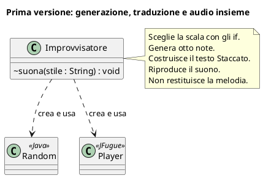
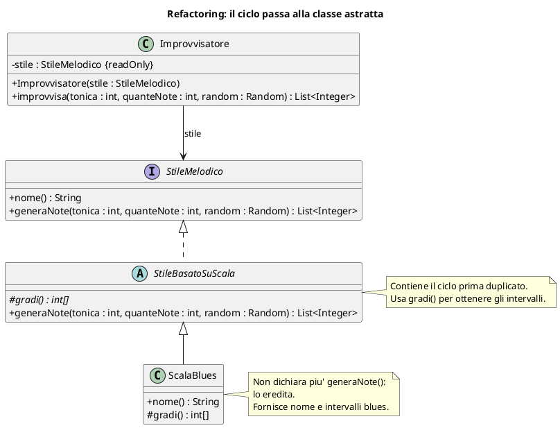

# 🎹 Improvvisatore musicale: dal codice al PlantUML

**4CI · Lettura del codice e diagramma delle classi**

Questa dispensa rappresenta il codice di [Ingegneria del software e casi di studio](Ingegneria%20del%20software%20e%20casi%20di%20studio.md). I diagrammi distinguono le versioni: non bisogna mescolare una classe prima del refactoring con la sua versione successiva.

I blocchi sono sorgenti **PlantUML**. Per visualizzarli serve un renderer compatibile: Obsidian non li rende automaticamente come Mermaid senza un'integrazione apposita. Non inviare codice riservato a renderer online; preferire un renderer locale quando necessario.

## 1. La prima versione: tutto nello stesso componente

Il simbolo `~` corrisponde alla visibilità di package: nella prima versione `suona` non è dichiarato `public`.

**Domanda:** se vogliamo verificare le note senza suonarle, quale responsabilità dobbiamo separare?

## 2. La versione separata, prima di estrarre il ciclo comune

Questo diagramma rappresenta la versione in cui gli stili implementano direttamente `StileMelodico`. Include le due estensioni introdotte successivamente, pentatonica e arpeggio, prima del refactoring.

```plantuml
@startuml
title Improvvisatore: responsabilita separate, prima del refactoring
skinparam classAttributeIconSize 0
hide empty members

interface StileMelodico {
    + nome() : String
    + generaNote(tonica : int, quanteNote : int, random : Random) : List<Integer>
}

class ScalaMaggiore {
    - {static} GRADI : int[] {readOnly}
    + nome() : String
    + generaNote(tonica : int, quanteNote : int, random : Random) : List<Integer>
}
class ScalaBlues {
    - {static} GRADI : int[] {readOnly}
    + nome() : String
    + generaNote(tonica : int, quanteNote : int, random : Random) : List<Integer>
}
class PentatonicaMinore {
    - {static} GRADI : int[] {readOnly}
    + nome() : String
    + generaNote(tonica : int, quanteNote : int, random : Random) : List<Integer>
}
class ArpeggioMinore {
    - {static} GRADI : int[] {readOnly}
    + nome() : String
    + generaNote(tonica : int, quanteNote : int, random : Random) : List<Integer>
}

class Improvvisatore {
    - stile : StileMelodico {readOnly}
    + Improvvisatore(stile : StileMelodico)
    + improvvisa(tonica : int, quanteNote : int, random : Random) : List<Integer>
}

class TraduttoreStaccato {
    + traduci(note : List<Integer>) : String
}

interface Uscita {
    + riproduci(staccato : String) : void
}
class UscitaAudio {
    - player : Player {readOnly}
    + riproduci(staccato : String) : void
}
class UscitaMidiFile {
    - file : File {readOnly}
    + UscitaMidiFile(file : File)
    + riproduci(staccato : String) : void
}
class Studio {
    + {static} main(args : String[]) : void
}

class Player <<JFugue>>
class Pattern <<JFugue>>
class MidiFileManager <<JFugue>>
class File <<Java>>

' Realizzazione: linea tratteggiata e triangolo verso il contratto.
StileMelodico <|.. ScalaMaggiore
StileMelodico <|.. ScalaBlues
StileMelodico <|.. PentatonicaMinore
StileMelodico <|.. ArpeggioMinore
Uscita <|.. UscitaAudio
Uscita <|.. UscitaMidiFile

' Associazione: il coordinatore conserva il riferimento ricevuto nel costruttore.
Improvvisatore --> StileMelodico : stile
UscitaAudio --> Player : player
UscitaMidiFile --> File : file

' Dipendenze: Studio assembla e usa i componenti nel main.
Studio ..> ScalaBlues : crea
Studio ..> StileMelodico : usa
Studio ..> Improvvisatore : crea e usa
Studio ..> TraduttoreStaccato : crea e usa
Studio ..> Uscita : usa
Studio ..> UscitaAudio : crea

' Dettagli esterni usati dalle implementazioni delle uscite.
UscitaAudio ..> Pattern : crea
UscitaMidiFile ..> Pattern : crea
UscitaMidiFile ..> MidiFileManager : usa

note bottom of StileMelodico
  Strategy per la generazione:
  le implementazioni restituiscono dati,
  non riproducono audio.
end note

note bottom of Uscita
  Strategy per la destinazione.
  Nel main mostrato viene scelta UscitaAudio;
  UscitaMidiFile e' disponibile ma non selezionata.
end note
@enduml
```

### Come leggerlo

- `+`: pubblico; `-`: privato; `#`: protetto; `~`: visibilità di package.
- `{static}`: membro della classe, non della singola istanza.
- `{readOnly}`: riferimento o campo non riassegnabile; per un array **non** significa che gli elementi siano immutabili.
- Triangolo con linea tratteggiata: **realizzazione di un'interfaccia**.
- Linea continua con freccia: **associazione navigabile**, qui un riferimento conservato in un campo.
- Freccia tratteggiata: **dipendenza**, per esempio creazione o uso dentro un metodo.

Sono riportati i campi e i metodi dichiarati rilevanti. Per leggibilità, non vengono disegnati tutti i tipi Java, le variabili locali e i dettagli interni delle librerie.

Non usiamo automaticamente rombi di composizione: avere un campo non dimostra da solo un rapporto UML di proprietà esclusiva e ciclo di vita. Le molteplicità non sono specificate perché il codice mostrato non valida tutti i riferimenti e il diagramma non deve inventare garanzie.

**Attenzione al codice reale:** JFugue compare in `UscitaAudio` **e** in `UscitaMidiFile`. La generazione delle note, invece, non dipende da JFugue. Cambiare libreria può richiedere di adattare entrambe le uscite.

## 3. Il refactoring mostrato: estrarre la generazione comune

La dispensa mostra la classe astratta e la riscrittura di `ScalaBlues`. Questo diagramma rappresenta esattamente quel passaggio; non presume che le altre classi siano già state riscritte.

**Che cosa cambia:** il ciclo di generazione si sposta nella classe astratta; `ScalaBlues` passa da `implements StileMelodico` a `extends StileBasatoSuScala`.

**Che cosa non cambia:** il contratto usato da `Improvvisatore` e gli intervalli blues. Anche gli altri stili possono essere convertiti allo stesso schema, mantenendo i propri intervalli e nomi.

## Domande di lettura

1. Perché `Improvvisatore` ha un'associazione con `StileMelodico`, mentre `Studio` ha dipendenze verso più classi?
2. Perché il diagramma del refactoring non elenca `generaNote` dentro `ScalaBlues`?
3. Quali componenti devono conoscere JFugue?
4. Perché non disegniamo una relazione «il generatore eredita dal riproduttore»?

Per esercitarsi nel verso opposto, vedere [Dal testo al progetto — robot esploratore](Dal%20testo%20al%20progetto%20-%20robot%20esploratore%20e%20UML.md).
