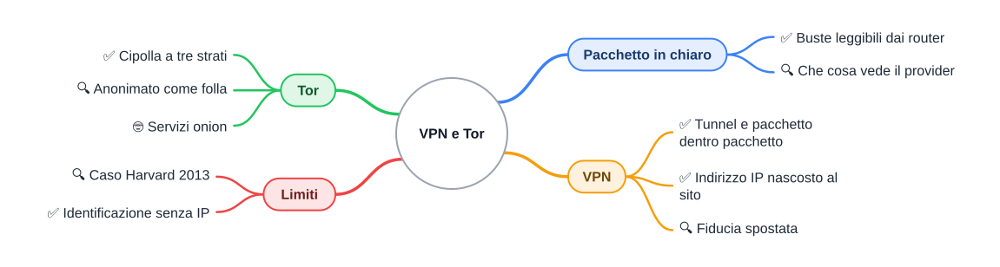

# 🕵️ VPN e Tor: chi ti guarda mentre navighi?

**4DI · Integrazione dopo sett-ott · Curiosità**

⏱️ **Tempo di lettura: circa 30 minuti.** ✅ essenziale: 15 min. 🔍 per capire fino in fondo: 10 min. 🤓 si può saltare. Nessun compito a casa.

> **Legenda:** ✅ da sapere · 🔍 per capire fino in fondo · 🤓 facoltativo · 📜 storia · 🧪 esempio · ⚠️ errore comune · 🧠 da ricordare · ✏️ da fare · 🃏 flashcard (rispondi a voce, poi apri)

## 🗺️ Mappa

## 📜 La cartolina che attraversa il mondo

Ricordi `tracert` e il viaggio di un pacchetto in S1 e S3? Il tuo messaggio passa da 10, 15, a volte 20 router. Ogni router apre la busta più esterna, legge l'indirizzo IP di destinazione e decide dove spedirla.

<u>Un pacchetto normale è una cartolina, non una lettera chiusa.</u> Il contenuto spesso è protetto (di questo si occupa HTTPS, il «lucchetto» del browser, che cifra tra te e il sito). Ma **chi sei** e **dove vai** sono scritti sulla busta, e chiunque la maneggi li può leggere.

Chi la maneggia? Il router di casa, il tuo provider, i provider intermedi, il Wi-Fi del bar. Questa dispensa racconta due modi opposti di rispondere al problema. Il primo è nato per le aziende, il secondo per le spie. Poi, come in tutte le belle storie, le parti si sono ribaltate.

## 🛡️ VPN: il corridoio privato dentro Internet

### 📜 Una storia di uffici lontani

Siamo nel 1996. Un'azienda ha una sede a Milano e una a Palermo. Vuole che i computer delle due sedi si vedano come se fossero nello stesso edificio: stesse stampanti, stessi server, indirizzi privati tipo `10.0.0.x`.

C'è un problema che conosci da S4: <u>gli indirizzi privati non viaggiano su Internet.</u> I router di Internet li scartano. Affittare una linea dedicata Milano-Palermo costa un patrimonio.

L'idea, nata in quegli anni (uno dei primi protocolli fu PPTP, di Microsoft e altri): usare comunque Internet, ma **mettere tutto il pacchetto privato dentro un altro pacchetto**, chiuso a chiave. Per Internet è traffico qualunque fra due indirizzi pubblici. Per le due sedi è un corridoio privato. Lo chiamarono **VPN**, *Virtual Private Network*: una rete privata, ma virtuale, perché i cavi sono quelli di tutti.

### ✅ Pacchetto dentro pacchetto

Hai già visto l'incapsulamento: una busta dentro l'altra. Qui si fa lo stesso, con un trucco in più: <u>un intero pacchetto IP diventa il contenuto di un altro pacchetto IP, e il contenuto è cifrato.</u> Questo si chiama **tunnel**.

🧪 **Esempio con numeri inventati** (gli indirizzi `203.0.113.x`, `198.51.100.x` e `192.0.2.x` sono riservati agli esempi):

| Passo | Da | A | Che cosa si legge |
|---|---|---|---|
| 1. Il tuo PC prepara il pacchetto | `10.8.0.2` (indirizzo privato nella VPN) | `192.0.2.80` (il sito) | È il pacchetto vero |
| 2. Lo chiude nel tunnel: busta esterna | `203.0.113.7` (casa tua, dopo il NAT) | `198.51.100.9` (server VPN) | Busta esterna leggibile, **dentro tutto illeggibile** |
| 3. Il server VPN apre e inoltra | `198.51.100.9` | `192.0.2.80` | Il sito vede solo l'indirizzo del server VPN |

Il provider di casa vede solo il passo 2: «questo cliente parla col server `198.51.100.9`». Non sa quale sito visiti, né che cosa scambi. Il sito vede solo il passo 3: non sa dove abiti.

Nota che il passo 3 usa il **NAT** di S4: il server VPN riscrive l'indirizzo di partenza, come fa il router di casa tua.

🃏 <b>Che cos'è un tunnel VPN?</b>

Un pacchetto IP cifrato messo dentro un altro pacchetto IP. <i>Il provider vede la busta esterna, ma non può leggere quella interna.</i>

🃏 <b>Che cosa vede il sito che visiti, se usi una VPN?</b>

L'indirizzo IP del server VPN, non il tuo.

### 🔍 La fiducia non sparisce, si sposta

Le pubblicità dei VPN commerciali dicono «naviga in modo anonimo e invisibile». Con la tabella sopra puoi capire che cosa c'è di vero.

Chi sa prima tutto di te? Il provider di casa. Con la VPN, il provider di casa non vede più nulla di utile. Ma **adesso vede tutto il server VPN**: la tua vera identità (ti sei registrato e magari hai pagato) e ogni sito che visiti.

<u>Una VPN non elimina un osservatore: ne cambia uno con un altro.</u> Devi decidere di chi fidarti di più. Per questo conta se il provider VPN conserva i *log*, cioè gli appunti su chi si è collegato e quando. Nel 2017 si è saputo che un provider che si presentava come «senza log» aveva fornito all'FBI informazioni che aiutarono a identificare un utente in un caso di stalking. Una promessa pubblicitaria non è un fatto verificabile.

🧪 Dove funziona davvero bene: il Wi-Fi del bar o della stazione, dove non ti fidi di chi gestisce la rete; la connessione sicura alla rete della scuola o dell'azienda da casa; la scelta di dove sembri essere (per questo una VPN può «cambiare paese»).

> 😄 Se hai guardato YouTube, conosci l'ormai leggendaria frase «Questo video è sponsorizzato da…» seguita da una VPN. Ora sai che cosa vendono davvero: non l'invisibilità, ma **un osservatore diverso**.

⚠️ <u>Una VPN non ti protegge da un sito che sa già chi sei:</u> se fai login con il tuo account, il sito ti riconosce comunque, qualunque indirizzo IP tu usi.

🃏 <b>Perché una VPN non ti rende davvero anonimo?</b>

Perché il provider VPN vede sia chi sei sia dove vai. <i>Hai spostato la fiducia, non l'hai tolta.</i>

## 🧅 Tor: tre sconosciuti che non si parlano

### 📜 Un'invenzione della Marina americana

Ora la storia più strana. Metà anni Novanta: al laboratorio di ricerca della **Marina degli Stati Uniti** si pongono un problema da spie. Come far comunicare agenti sul campo via Internet senza che chi controlla la rete capisca chi parla con chi? Anche il solo fatto di collegarsi a un certo server può tradire.

La soluzione si chiama **onion routing**: invece di un solo corridoio, una catena di computer, ognuno dei quali conosce solo un pezzo del percorso. Tre computer che non si parlano fra loro, e nessuno dei quali sa tutto.

Poi arriva il paradosso. Un sistema usato solo da agenti segreti non funziona: se sei l'unico che usa la maschera, sei subito riconoscibile. <u>L'anonimato ha bisogno della folla.</u> Per proteggere gli agenti serviva che lo usassero anche giornalisti, attivisti, studenti, persone comuni.

Così il codice fu pubblicato come software libero (2004) e dal 2006 il progetto è gestito da un'organizzazione senza scopo di lucro, il **Tor Project**. Tor sta per *The Onion Router*. Oggi la rete è fatta da migliaia di computer di volontari in tutto il mondo, e la usano redazioni giornalistiche, dissidenti sotto regimi che censurano Internet, e chiunque non voglia essere tracciato. Ma la usa anche chi fa cose illegali, e questo ne fa un tema molto discusso.

### ✅ La cipolla a tre strati

Ricordi le buste di S1? Tor è l'incapsulamento, ma con le buste **chiuse a chiave**.

Anna vuole visitare un sito. Il suo computer sceglie a caso tre nodi: **Guardia** (entrata), **Mezzo** e **Uscita**. Poi prepara tre buste una dentro l'altra, ciascuna chiusa con la chiave di un nodo diverso:

1. busta esterna (chiave della Guardia): dice «passa a Mezzo»;
2. busta di mezzo (chiave di Mezzo): dice «passa a Uscita»;
3. busta interna (chiave di Uscita): dice «consegna al sito» e contiene la richiesta.

Ognuno apre **solo la sua busta**, vede l'istruzione, inoltra. Nessuno apre le altre.

| Chi | Sa chi è Anna? | Sa dove va? |
|---|---|---|
| **Guardia** | ✅ sì, riceve da lei | ❌ no, vede solo «passa a Mezzo» |
| **Mezzo** | ❌ no, vede solo la Guardia | ❌ no, vede solo «passa a Uscita» |
| **Uscita** | ❌ no, vede solo Mezzo | ✅ sì, deve consegnare al sito |
| **Il sito** | ❌ no, vede l'indirizzo di Uscita | ✅ ovviamente |

<u>Nessun singolo nodo sa insieme «chi sei» e «dove vai».</u> Per ricostruire il viaggio bisogna controllare più pezzi della catena. Ogni circa 10 minuti Tor sceglie un percorso nuovo.

🧠 La differenza chiave con la VPN: nella VPN un solo soggetto sa tutto. In Tor la conoscenza è **divisa fra tre sconosciuti**.

⚠️ <u>L'ultimo tratto, da Uscita al sito, non è protetto da Tor.</u> Se il sito non usa HTTPS, chi gestisce Uscita può leggere il contenuto. Chi gestisce un nodo di uscita è un volontario qualunque, perciò non inserire mai password in un sito senza HTTPS, anche con Tor.

🃏 <b>Perché Tor usa tre nodi e non uno?</b>

Perché così nessun nodo conosce insieme chi sei e dove vai. <i>Con un solo nodo, quel nodo saprebbe tutto, come in una VPN.</i>

🃏 <b>Che cosa sa il nodo di uscita?</b>

Sa dove va il messaggio (il sito), ma non chi l'ha mandato.

### 🔍 Il prezzo: lentezza e folla

Tre rimbalzi fra volontari in tutto il mondo rendono Tor più lenta di una VPN. Va bene per leggere, meno per guardare video.

Il secondo prezzo è più sottile: <u>se qualcuno osserva sia l'entrata sia l'uscita, può confrontare orari e quantità di dati e indovinare che sono lo stesso viaggio.</u> È l'attacco di *correlazione*. Per questo Tor non promette di battere un nemico che controlla mezza rete.

### 🔍 Il caso Harvard, 2013

Dicembre 2013. Una minaccia di bomba anonima, inviata per saltare un esame, costringe a evacuare edifici dell'università di Harvard. L'autore usava Tor, quindi niente indirizzo da rintracciare.

Ma gli investigatori guardarono i registri della rete del campus e notarono che, nel momento esatto dell'e-mail, **una sola persona** aveva collegato il proprio computer a Tor in quella rete. Interrogato, lo studente confessò.

Nessuno aveva rotto la cipolla. Aveva tradito lui, perché era l'unica persona con la maschera. <u>L'anonimato di Tor si indebolisce quando sei da solo nella folla.</u>

> 🤓 **Servizi onion.** Gli indirizzi che finiscono in `.onion` fanno una cosa ancora più strana: <u>nemmeno il sito conosce il tuo indirizzo, e tu non conosci il suo.</u> Si incontrano a metà strada, in un «punto di appuntamento» scelto dalla rete, ciascuno con la sua catena di nodi. Per questo sono usati anche da redazioni giornalistiche per ricevere segnalazioni da fonti protette.

## ⚖️ Chi vede che cosa?

🧠 Questa tabella è il cuore della dispensa. Leggila per colonne.

| Chi osserva | Senza nulla | Con VPN | Con Tor | Con Tor + HTTPS |
|---|---|---|---|---|
| **Provider di casa** | tutti i siti che visiti | solo «parla col server VPN» | solo «usa Tor» | solo «usa Tor» |
| **Server VPN / nodo di uscita** | (non c'è) | tutto: chi sei e dove vai | dove vai, non chi sei | dove vai, **non il contenuto** |
| **Il sito** | il tuo IP | l'IP del server VPN | l'IP del nodo di uscita | l'IP del nodo di uscita |
| **Nessuno vede tutto?** | ❌ | ❌ (lo vede il provider VPN) | ✅ in condizioni normali | ✅ in condizioni normali |

🔍 Nessuno strumento ti rende invisibile. Ti permette di scegliere **chi** può vederti: il provider di casa, un'azienda a cui ti affidi, oppure nessuno in particolare.

> 😄 **Per ricordare i limiti:** in un celebre fumetto di XKCD ([xkcd.com/538](https://xkcd.com/538/)), un attaccante decide di non violare la crittografia: colpisce la persona con una chiave inglese finché non dice la password. Moltissime volte il punto debole non è la matematica, ma una persona.

## 🧰 Quale scegliere?

| Voglio… | Strumento adatto |
|---|---|
| Usare il Wi-Fi del bar senza farmi curiosare | VPN di un fornitore di cui mi fido |
| Collegarmi alla rete della scuola o dell'azienda da casa | VPN aziendale |
| Leggere informazioni dove Internet è censurato | Tor (con Tor Browser) |
| Non far sapere né al provider né al sito chi sono | Tor, senza fare login con i tuoi account |
| Guardare video in streaming | Nessuno dei due: sono lenti o inutili qui |

⚠️ Usare VPN e Tor è **legale** in Italia e in Europa. Quello che puoi farci non lo è sempre: compiere reati restando nascosti resta un reato, e come mostra il caso Harvard, nascondersi non è garantito.

## ✏️ Da fare

1. **Il gioco delle buste (10 min, in 4).** Una persona è Anna, tre sono Guardia, Mezzo e Uscita. Anna scrive un messaggio per un «sito» (un foglio sul banco) e lo mette in tre buste, ciascuna con scritto fuori «per Guardia», «per Mezzo», «per Uscita». Ogni nodo apre solo la sua busta e passa il resto. Poi rispondete: a metà strada, chi sapeva chi era Anna?
2. **Completa (3 min).** Riscrivi da solo la tabella «Chi vede che cosa?» per «Con VPN», senza guardare. Poi controlla.
3. **Spiegalo (1 min).** Spiega a voce, in una frase, perché Tor ha tre nodi e la VPN uno.

🃏 <b>VPN o Tor: Wi-Fi del bar?</b>

VPN. <i>L'obiettivo è proteggersi da chi gestisce quella rete, e di solito non serve l'anonimato forte.</i>

🃏 <b>VPN o Tor: nascondere chi sei sia al provider sia al sito?</b>

Tor, perché nessun singolo nodo sa insieme chi sei e dove vai.

🃏 <b>Perché Tor ha bisogno di tanta gente?</b>

Perché l'anonimato funziona nella folla. <i>Se usa Tor solo una persona nella rete, quella persona si riconosce subito.</i>

## 📚 Per approfondire

- 🛠️ **Tor Browser** ([torproject.org](https://www.torproject.org/)): il programma ufficiale, gratuito. Prova solo su reti e dispositivi tuoi, e leggi la guida prima.
- 🎬 La pagina «How Tor works» sul sito del Tor Project: spiega per immagini i tre nodi.
- 📜 In S1 e S3 trovi buste, incapsulamento e NAT: sono gli ingredienti di tutto questo.

---

*Si collega a S1 (modelli e incapsulamento), S3 (IPv4 e il pacchetto) e S4 (reti private e NAT). Gli indirizzi degli esempi sono inventati e riservati alla documentazione.*
tuo indirizzo, e tu non conosci il suo.</u> Si incontrano a metà strada, in un «punto di appuntamento» scelto dalla rete, ciascuno con la sua catena di nodi. Per questo sono usati anche da redazioni giornalistiche per ricevere segnalazioni da fonti protette.

## ⚖️ Chi vede che cosa?

🧠 Questa tabella è il cuore della dispensa. Leggila per colonne.

| Chi osserva | Senza nulla | Con VPN | Con Tor | Con Tor + HTTPS |
|---|---|---|---|---|
| **Provider di casa** | tutti i siti che visiti | solo «parla col server VPN» | solo «usa Tor» | solo «usa Tor» |
| **Server VPN / nodo di uscita** | (non c'è) | tutto: chi sei e dove vai | dove vai, non chi sei | dove vai, **non il contenuto** |
| **Il sito** | il tuo IP | l'IP del server VPN | l'IP del nodo di uscita | l'IP del nodo di uscita |
| **Nessuno vede tutto?** | ❌ | ❌ (lo vede il provider VPN) | ✅ in condizioni normali | ✅ in condizioni normali |

🔍 Nessuno strumento ti rende invisibile. Ti permette di scegliere **chi** può vederti: il provider di casa, un'azienda a cui ti affidi, oppure nessuno in particolare.

> 😄 **Per ricordare i limiti:** in un celebre fumetto di XKCD ([xkcd.com/538](https://xkcd.com/538/)), un attaccante decide di non violare la crittografia: colpisce la persona con una chiave inglese finché non dice la password. Moltissime volte il punto debole non è la matematica, ma una persona.

## 🧰 Quale scegliere?

| Voglio… | Strumento adatto |
|---|---|
| Usare il Wi-Fi del bar senza farmi curiosare | VPN di un fornitore di cui mi fido |
| Collegarmi alla rete della scuola o dell'azienda da casa | VPN aziendale |
| Leggere informazioni dove Internet è censurato | Tor (con Tor Browser) |
| Non far sapere né al provider né al sito chi sono | Tor, senza fare login con i tuoi account |
| Guardare video in streaming | Nessuno dei due: sono lenti o inutili qui |

⚠️ Usare VPN e Tor è **legale** in Italia e in Europa. Quello che puoi farci non lo è sempre: compiere reati restando nascosti resta un reato, e come mostra il caso Harvard, nascondersi non è garantito.

## ✏️ Da fare

1. **Il gioco delle buste (10 min, in 4).** Una persona è Anna, tre sono Guardia, Mezzo e Uscita. Anna scrive un messaggio per un «sito» (un foglio sul banco) e lo mette in tre buste, ciascuna con scritto fuori «per Guardia», «per Mezzo», «per Uscita». Ogni nodo apre solo la sua busta e passa il resto. Poi rispondete: a metà strada, chi sapeva chi era Anna?
2. **Completa (3 min).** Riscrivi da solo la tabella «Chi vede che cosa?» per «Con VPN», senza guardare. Poi controlla.
3. **Spiegalo (1 min).** Spiega a voce, in una frase, perché Tor ha tre nodi e la VPN uno.

🃏 <b>VPN o Tor: Wi-Fi del bar?</b>

VPN. <i>L'obiettivo è proteggersi da chi gestisce quella rete, e di solito non serve l'anonimato forte.</i>

🃏 <b>VPN o Tor: nascondere chi sei sia al provider sia al sito?</b>

Tor, perché nessun singolo nodo sa insieme chi sei e dove vai.

🃏 <b>Perché Tor ha bisogno di tanta gente?</b>

Perché l'anonimato funziona nella folla. <i>Se usa Tor solo una persona nella rete, quella persona si riconosce subito.</i>

## 📚 Per approfondire

- 🛠️ **Tor Browser** ([torproject.org](https://www.torproject.org/)): il programma ufficiale, gratuito. Prova solo su reti e dispositivi tuoi, e leggi la guida prima.
- 🎬 La pagina «How Tor works» sul sito del Tor Project: spiega per immagini i tre nodi.
- 📜 In S1 e S3 trovi buste, incapsulamento e NAT: sono gli ingredienti di tutto questo.

---

*Si collega a S1 (modelli e incapsulamento), S3 (IPv4 e il pacchetto) e S4 (reti private e NAT). Gli indirizzi degli esempi sono inventati e riservati alla documentazione.*
