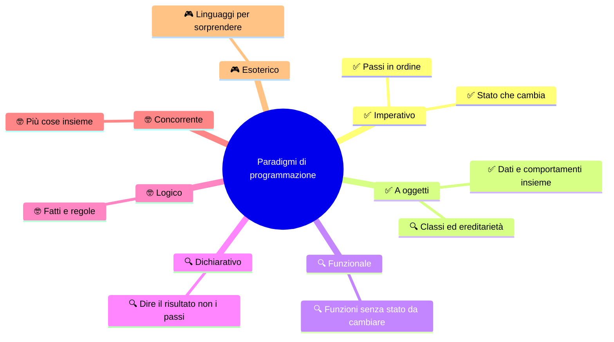

📚 Collegata a: [(STU) 4CI nov-dic S1 - Primi passi con Python](../../4CI%20-%20Informatica/2%20NOV-DIC/%28STU%29%204CI%20nov-dic%20S1%20-%20Primi%20passi%20con%20Python.md)

# 🗺️ Paradigmi e linguaggi: modi diversi di pensare il programma

> **Legenda:** ✅ da sapere · 🔍 per capire fino in fondo · 🤓 per curiosi · 📜 storia · 🧪 esempio · 🎮 easter egg (un linguaggio fatto per sorprendere o far ridere) · 🃏 flashcard · ✏️ da fare

Ogni linguaggio è una lingua. Ogni **paradigma** è un modo di pensare il programma: prima di scegliere le parole, scegli come organizzare la storia. Python parla più di una lingua, e questa integrazione ti mostra quali.



## 🌍 Un paradigma non è un linguaggio

Un **paradigma** è un modo di organizzare il programma. Un linguaggio può supportarne uno solo o parecchi.

🧪 Lo stesso calcolo, la media di tre voti, si può scrivere in tre modi diversi. Il risultato è sempre `6.666...`, ma cambia il modo di pensare:

- **Imperativo:** dico alla macchina i passi, uno dopo l'altro, e modifico una variabile `totale`.
- **Funzionale:** descrivo il risultato come una funzione di una lista, senza modificare niente.
- **Dichiarativo:** scrivo una domanda (un `SELECT`) e lascio che il sistema decida come rispondere.

<details>
<summary>🃏 <b>Che cos'è un paradigma di programmazione?</b></summary>
Un modo di organizzare il programma: come i passi sono descritti, come è organizzato il codice e che cosa può cambiare durante l'esecuzione.
</details>
<details>
<summary>🃏 <b>Un linguaggio può avere più paradigmi?</b></summary>
Sì. Python è imperativo, a oggetti e in parte funzionale.
</details>

## ✅ I paradigmi principali

### ✅ Imperativo: dire alla macchina i passi

È il paradigma più antico e più vicino alla macchina: il programma è una lista di ordini, eseguiti uno dopo l'altro, e lo **stato** (il valore delle variabili) cambia man mano.

🧪 Calcolare il totale dei voti, passo per passo:

```python
totale = 0
for voto in [7, 4, 9]:
    totale = totale + voto
print(totale / 3)   # 6.666...
```

Fortran (1957) e C (1972) sono linguaggi imperativi. Anche Java, quando scrivi un metodo con cicli e variabili, usa questo modo di pensare.

<details>
<summary>🃏 <b>Che cosa caratterizza il paradigma imperativo?</b></summary>
Una lista di passi, eseguiti in ordine, che modificano lo stato del programma.
</details>

### ✅ A oggetti: dati e comportamenti insieme

Un **oggetto** tiene insieme i suoi dati e le cose che sa fare. Il programma diventa una collezione di oggetti che si scambiano messaggi.

```python
class Eroe:
    def __init__(self, nome):
        self.nome = nome

    def saluta(self):
        return f"Sono {self.nome}"

print(Eroe("Aria").saluta())   # Sono Aria
```

Simula 67, linguaggio nato in Norvegia, introduce le classi. **Smalltalk**, negli anni Settanta allo Xerox PARC, rende il paradigma un'idea centrale: gli oggetti si mandano messaggi. Java e Python arrivano dopo, con due modi diversi di applicarla: il primo obbliga a usare le classi, il secondo le offre come strumento.

<details>
<summary>🃏 <b>Che cosa tiene insieme un oggetto?</b></summary>
I suoi dati (attributi) e il suo comportamento (metodi).
</details>

### 🔍 Funzionale: funzioni senza stato da cambiare

Nel paradigma funzionale il programma è un insieme di **funzioni pure**: stesso input, stesso output, nessuna variabile modificata di nascosto. Il risultato si ottiene componendo funzioni, non cambiando lo stato.

```python
voti = [7, 4, 9]
print(sum(voti) / len(voti))            # 6.666...
print(list(map(lambda v: v + 1, voti))) # [8, 5, 10]
```

Il linguaggio **Lisp** (1958, John McCarthy, al MIT) è uno dei primi a dare questo modo di pensare. **Haskell** (1990) ne è l'esempio più rigoroso. Java ha introdotto le *lambda* nel 2014: piccole funzioni passate come valori.

🧪 `lambda v: v + 1` è una funzione senza nome, scritta lì dove serve.

<details>
<summary>🃏 <b>Che cos'è una funzione pura?</b></summary>
Una funzione che restituisce sempre lo stesso risultato per lo stesso input e non cambia nulla fuori da sé.
</details>

### 🔍 Dichiarativo: dire il risultato, non i passi

Nel paradigma dichiarativo descrivi **che cosa** vuoi, non **come** calcolarlo. Il sistema sceglie i passi.

```python
import sqlite3
con = sqlite3.connect(":memory:")
con.execute("CREATE TABLE studenti (nome TEXT, voto INTEGER)")
con.executemany("INSERT INTO studenti VALUES (?, ?)",
                [("Aria", 7), ("Luca", 4), ("Sara", 9)])
print(con.execute(
    "SELECT nome FROM studenti WHERE voto >= 6 ORDER BY nome").fetchall())
# [('Aria',), ('Sara',)]
```

La riga `SELECT ... WHERE voto >= 6` dice che cosa vuoi. Non dice come cercare: il database decide. Il linguaggio SQL, nato negli anni Settanta, è il più diffuso esempio di questo paradigma. Anche i fogli di calcolo, dove una formula si aggiorna da sola quando cambia un dato, ragionano in modo simile.

<details>
<summary>🃏 <b>Che differenza c'è fra imperativo e dichiarativo?</b></summary>
Imperativo: dico i passi. Dichiarativo: dico il risultato e lascio che il sistema scelga i passi.
</details>

### 🤓 Logico: fatti e regole

Nel paradigma logico scrivi **fatti** e **regole**, e il programma risponde alle domande deducendo.

Il linguaggio **Prolog** (1972, Alain Colmerauer, Università di Marsiglia) funziona così. Un esempio in stile Prolog, non eseguito in classe:

```text
genitore(anna, luca).
genitore(luca, marco).
nonno(X, Y) :- genitore(X, Z), genitore(Z, Y).
```

Alla domanda `nonno(anna, marco)?` il sistema risponde sì: deduce che Anna è genitore di Luca, e Luca di Marco.

<details>
<summary>🃏 <b>Che cosa fa un programma logico?</b></summary>
Risponde a domande deducendo dai fatti e dalle regole che gli hai scritto.
</details>

### 🤓 Concorrente e reattivo

Un programma concorrente fa più cose insieme: due thread, un server che risponde a più persone, un'app che scarica un file mentre l'utente scrive. I programmi reattivi reagiscono a eventi e flussi di dati: un clic, un messaggio, un sensore.

Il tema diventa centrale quando i programmi girano su più processori o in rete: lo vedrai nei corsi successivi di sistemi e reti.

## 📚 La famiglia dei linguaggi

Una linea del tempo sintetica. Le date sono di nascita o di prima diffusione.

| Anno | Linguaggio | Chi lo crea | Perché nasce | Paradigma |
| --- | --- | --- | --- | --- |
| 1957 | Fortran | IBM, John Backus | formule scientifiche | imperativo |
| 1958 | Lisp | John McCarthy, MIT | calcolo simbolico | funzionale |
| 1959 | COBOL | comitato CODASYL, con Grace Hopper | conti delle aziende | imperativo |
| 1972 | C | Dennis Ritchie, Bell Labs | sistema Unix | imperativo |
| 1972 | Prolog | Alain Colmerauer | intelligenza artificiale, logica | logico |
| anni '70 | Smalltalk | Alan Kay e colleghi, Xerox PARC | interfacce e oggetti | a oggetti |
| 1991 | Python | Guido van Rossum | leggibilità, uso didattico e pratico | multi-paradigma |
| 1995 | Java | Sun Microsystems, James Gosling | «scrivi una volta, esegui ovunque» | a oggetti, tipizzato |
| 1995 | JavaScript | Brendan Eich, Netscape | siti web interattivi | multi-paradigma |
| 2009 | Go | Google | programmi di rete veloci e semplici | imperativo, concorrente |
| 2015 | Rust | Mozilla | sicurezza della memoria senza garbage collector | multi-paradigma |

📜 **JavaScript in dieci giorni.** Nel maggio 1995 Brendan Eich scrive il primo prototipo in circa dieci giorni, per Netscape. Quel linguaggio, pensato in fretta, oggi gira in quasi tutti i browser del mondo: la fretta ha lasciato qualche stranezza, ma ha vinto.

<details>
<summary>🃏 <b>Quale linguaggio è nato in dieci giorni?</b></summary>
JavaScript, nel 1995, da Brendan Eich, per il browser Netscape.
</details>

## 🎮 Gli esoterici

Un **linguaggio esoterico** è un linguaggio fatto per sorprendere, per far ridere o per sfidare i limiti del progetto. Non si usa per lavoro: si usa per riflettere su che cosa rende un linguaggio leggibile, potente o inutilmente complicato.

### 🎮 INTERCAL: il linguaggio che non si può pronunciare

📜 Nel 1972 due studenti di Princeton, Don Woods e James Lyon, creano **INTERCAL**: il nome è *Compiler Language With No Pronounceable Acronym*, cioè un linguaggio di compilazione senza un acronimo pronunciabile. Lo scrivono come parodia dei linguaggi dell'epoca.

Il tratto più famoso è la parola `PLEASE`. Se non la usi abbastanza, il compilatore ti dice che sei maleducato. Se la usi troppo, ti dice che sei troppo educato. Il manuale originale lo spiega con ironia.

🧪 Un frammento dal manuale originale: il modo più semplice di memorizzare 65536 in una variabile a 32 bit è, in INTERCAL, `DO :1 <- #0¢#256`. Il manuale aggiunge che un programmatore che scrive così sembrerebbe ridicolo, anche se ha ragione.

<details>
<summary>🃏 <b>Che cosa succede se in INTERCAL non usi abbastanza PLEASE?</b></summary>
Il compilatore rifiuta il programma: lo considera poco educato.
</details>

### 🎮 Brainfuck: otto comandi per tutto

📜 Nel 1993 lo studente svizzero Urban Müller crea **Brainfuck**. Ha solo otto comandi, che sono caratteri singoli:

| Comando | Che cosa fa |
| --- | --- |
| `>` | sposta il puntatore a destra |
| `<` | sposta il puntatore a sinistra |
| `+` | aumenta di 1 il valore sotto il puntatore |
| `-` | diminuisce di 1 il valore sotto il puntatore |
| `.` | stampa il carattere con quel valore |
| `,` | legge un carattere da tastiera |
| `[` `]` | ripete il blocco finché il valore sotto il puntatore non è zero |

🧪 Il programma «Hello World!» (verificato eseguendolo con un interprete Python scritto apposta):

```text
++++++++[>++++[>++>+++>+++>+<<<<-]>+>+>->>+[<]<-]>>.>---.+++++++..+++.>>.<-.<.+++.------.--------.>>+.>++.
```

Per capire il trucco, parti da un programma più piccolo, che stampa la lettera `A`:

```text
++++++++[>++++++++<-]>+.
```

La prima parte porta la prima cella a 8 e poi la ripete 8 volte, aggiungendo 8 alla cella successiva: ottieni 64. Il `+` finale fa 65, che è `A` nel codice ASCII. Il programma è corto, ma leggerlo è durissimo.

🤓 Brainfuck è un esempio di **Turing tarpit**, una «palude di Turing»: è completo, cioè può calcolare tutto ciò che calcola una macchina di Turing, ma è scomodo proprio perché non offre astrazioni. Vedi [Macchine di Turing e completezza](../Approfondimenti%20didattici/Macchine%20di%20Turing%20e%20completezza.md).

<details>
<summary>🃏 <b>Quanti comandi ha Brainfuck?</b></summary>
Otto: <code>&gt; &lt; + - . , [ ]</code>.
</details>
<details>
<summary>🃏 <b>Perché Brainfuck è completo e insieme scomodo?</b></summary>
Può calcolare tutto, ma non offre astrazioni come funzioni, variabili con nome o oggetti: ogni cosa va fatta a mano.
</details>

✏️ **Prevedi (1 min).** Che cosa stampa `++++++++++[>+++++++<-]>.`? Prima di pensare, non calcolare: costruisci la tabella delle celle.

### 🎮 Malbolge: il linguaggio quasi impossibile

📜 Nel 1998 Ben Olmstead crea **Malbolge**. Il nome viene da *Malebolge*, l'ottavo cerchio dell'Inferno di Dante, diviso in dieci fossati. Il linguaggio è progettato per essere quasi impossibile da programmare a mano: il programma cambia se stesso mentre gira.

🤓 Malbolge è un bel caso di scuola: mostra che un linguaggio può essere completo e tuttavia inutilizzabile da un essere umano.

### 🎮 Whitespace: il codice invisibile

📜 Nel 2002, all'Università di Durham, Edwin Brady e Chris Morris creano **Whitespace**. Qui contano solo tre caratteri: lo spazio, il tabulatore e il carattere di a capo. Tutto il resto è ignorato.

Ne consegue un fatto curioso: un programma Whitespace può nascondersi dentro un file scritto in un altro linguaggio, perché i suoi caratteri non si vedono. Lo strumento per vederlo è un editor che mostra gli spazi e i tab. Lo spazio diventa un'istruzione.

Il 1 aprile 2003 Slashdot pubblica una recensione del linguaggio: è uno scherzo, ma il linguaggio esiste davvero.

<details>
<summary>🃏 <b>Quali caratteri contano in Whitespace?</b></summary>
Spazio, tabulatore e a capo: gli altri caratteri sono ignorati.
</details>

### 🎮 Shakespeare: programmi che sembrano teatro

📜 Lo **Shakespeare Programming Language** è stato progettato da Jon Åslund e Karl Wiberg. Un programma è un copione teatrale: i personaggi (Romeo, Giulietta) sono variabili, che hanno un valore intero, e si scambiano battute. Le battute modificano i valori, e le domande fanno da condizioni `if`.

🧪 Il linguaggio ha una logica che ricorda l'assembly, ma è scritto come una commedia. Vederne un esempio, già con un atto e una scena, è più divertente che leggerne la spiegazione.

## 🧠 Che cosa ci insegnano gli esoterici

- **La leggibilità conta.** Python lo dice nello *Zen*: «Readability counts». Gli esoterici mostrano che cosa succede quando la leggibilità sparisce.
- **Potente non vuol dire comodo.** Brainfuck può calcolare tutto, ma per scrivere un programma serio servono astrazioni: funzioni, variabili con nome, oggetti.
- **Il linguaggio è una scelta.** Ogni caratteristica (parentesi, indentazione, tipi, nomi) è una decisione di chi lo ha progettato. Anche Java e Python lo sono.
- **Ridere aiuta a capire.** Il manuale di INTERCAL, scritto come una parodia, dice cose serie sulla leggibilità e sulla manutenzione del codice.

🧠 Ricorda: un linguaggio serve a parlare con le persone, non solo con la macchina.

## 🔗 Fonti e risorse

- [Esoteric programming language](https://en.wikipedia.org/wiki/Esoteric_programming_language): la panoramica dei linguaggi esoterici, con la storia di INTERCAL e Brainfuck.
- [Brainfuck](https://en.wikipedia.org/wiki/Brainfuck): le otto istruzioni e i programmi di esempio. Prova un interprete online per eseguire il «Hello World».
- [INTERCAL](https://en.wikipedia.org/wiki/INTERCAL): il manuale, la parola `PLEASE` e le implementazioni moderne.
- [Malbolge](https://en.wikipedia.org/wiki/Malbolge): la storia del linguaggio e il riferimento a Dante.
- [Whitespace](https://en.wikipedia.org/wiki/Whitespace_(programming_language)): il linguaggio in cui conta solo lo spazio bianco.
- [Shakespeare Programming Language](https://en.wikipedia.org/wiki/Shakespeare_Programming_Language): esempi di programmi come copioni teatrali.
- [Programming paradigm](https://en.wikipedia.org/wiki/Programming_paradigm): la classificazione completa dei paradigmi, con diagramma gerarchico.
- [JavaScript](https://en.wikipedia.org/wiki/JavaScript): la storia del linguaggio nato in dieci giorni.

---

📚 Collegata a: [(STU) 4CI nov-dic S1 - Primi passi con Python](../../4CI%20-%20Informatica/2%20NOV-DIC/%28STU%29%204CI%20nov-dic%20S1%20-%20Primi%20passi%20con%20Python.md)
